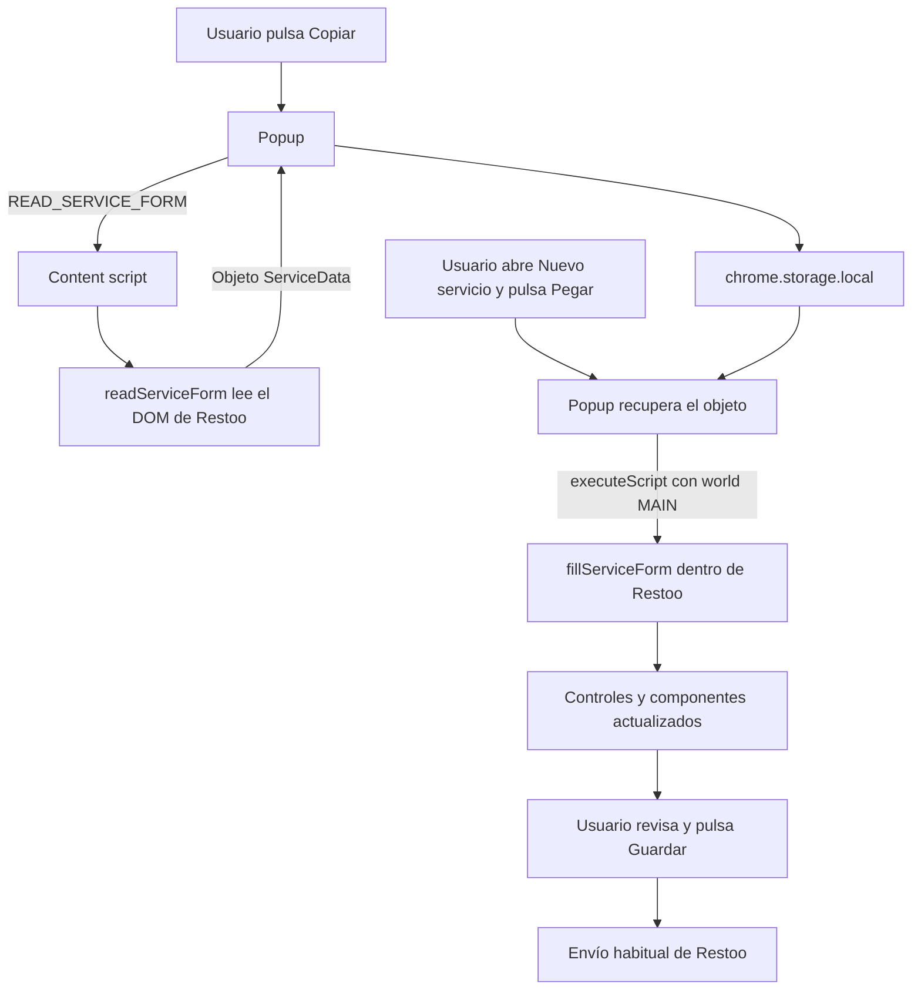
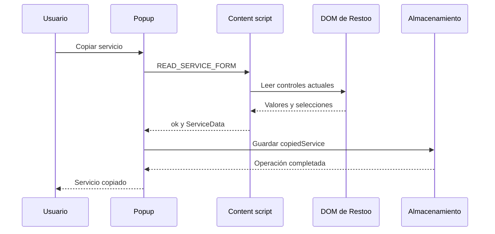

# Entender y construir la copia de servicios de Restoo

Guía de aprendizaje basada en el código del proyecto, revisado el 22 de septiembre de 2026.

Este documento explica cómo funciona la extensión que hemos ido construyendo y cómo podrías reconstruirla entendiendo cada decisión. Los fragmentos cortos son ejemplos didácticos: no sustituyas los archivos completos por ellos. Cuando se propone una mejora futura, se indica expresamente.

El código de referencia es [popup.tsx](./popup.tsx), [content.ts](./content.ts), [services.ts](./services.ts) y [service-paste.ts](./service-paste.ts). Las explicaciones describen su estado en la fecha de revisión; si posteriormente cambian los archivos, algunos detalles pueden variar.

## Cómo leer esta guía

Puedes leerla de principio a fin, pero no necesitas asimilar todo en una sesión. Una ruta útil es entender primero el recorrido completo, después los lenguajes y finalmente cada función. Los ejercicios del final sirven para comprobar que puedes construir las piezas sin copiar una solución grande.

- [1. Qué hemos construido](#objetivo)
- [2. Por qué ha crecido el código](#complejidad)
- [3. Archivos y contextos de ejecución](#arquitectura)
- [4. Cómo funciona un formulario en el navegador](#dom)
- [5. JavaScript que necesitas para leer este proyecto](#javascript)
- [6. TypeScript, desde los tipos básicos hasta nuestros casos](#typescript)
- [7. React y el popup](#react)
- [8. El objeto que representa el servicio](#modelo)
- [9. La lectura del formulario, paso a paso](#lectura)
- [10. El receptor de mensajes](#mensajes)
- [11. Qué sucede al pulsar Copiar](#copiar)
- [12. Qué sucede al pulsar Pegar](#pegar)
- [13. Horas, tramos, excepciones y verificación](#controles-especiales)
- [14. Errores, validación y límites de las garantías](#errores)
- [15. Configuración, permisos y compilación](#configuracion)
- [16. Cómo depurar y comprobar el resultado](#depuracion)
- [17. Decisiones actuales y mejoras posibles](#mejoras)
- [18. Aprender a reconstruirlo con ejercicios](#ejercicios)
- [19. Glosario](#glosario)
- [20. Documentación de referencia](#referencias)

<a id="objetivo"></a>

## 1. Qué hemos construido

La extensión permite leer un servicio abierto en Restoo, conservar sus datos y aplicarlos a un formulario de creación del mismo restaurante. El usuario revisa el resultado y pulsa el botón Guardar de Restoo.

Hay cuatro operaciones distintas:

1. **Leer:** obtener el estado actual de los controles del formulario.
2. **Representar:** convertir ese estado en un objeto de JavaScript que podamos transportar.
3. **Conservar:** guardar el objeto para que sobreviva al cierre del popup y a la navegación.
4. **Aplicar:** reconstruir el estado equivalente en el formulario de destino.

El guardado en el servidor sigue siendo responsabilidad de la página de Restoo. Nuestra función de pegado no llama a `fetch`, no construye una petición de creación y no pulsa Guardar.

Tampoco usamos el portapapeles del sistema. Los nombres de los botones describen la experiencia de uso, pero la copia se guarda en el almacenamiento de la extensión. No aparecerá automáticamente si pulsas Cmd+V en un editor.

La pestaña Alta conserva el trabajo anterior del formulario general. La pestaña Servicios contiene dos botones y un mensaje. El área de texto que propusimos inicialmente era una ayuda para inspeccionar los datos, no una necesidad del funcionamiento final.

### Lo que ya sabemos y lo que aún hay que probar

Al preparar esta guía, el proyecto pasó:

```bash
pnpm exec tsc --noEmit --incremental false
```

Eso comprueba el código con TypeScript. No demuestra que todos los controles de la página real respondan correctamente. La comprobación funcional exige abrir Restoo, copiar un servicio y revisar el formulario rellenado. Esta guía no da esa prueba por realizada.

<a id="complejidad"></a>

## 2. Por qué ha crecido el código

Copiar un campo de texto puede ser muy sencillo. Si ambos elementos existen en el mismo documento, la idea básica es:

```js
const origen = document.querySelector("#campo-origen")
const destino = document.querySelector("#campo-destino")

if (origen && destino) {
  destino.value = origen.value
}
```

Este ejemplo supone que los elementos son controles compatibles. Todavía no contempla navegación, persistencia, casillas, eventos ni componentes especiales.

En nuestro caso aparecen varias dificultades independientes:

| Dificultad | Consecuencia en el código |
| --- | --- |
| El popup tiene su propio documento | Necesitamos ejecutar la lectura en la pestaña de Restoo. |
| Se cierra el popup para navegar al destino | Necesitamos conservar el objeto fuera del estado de React. |
| Existen controles de diferentes tipos | Necesitamos reglas de lectura y escritura para cada uno. |
| Algunos controles comparten el mismo nombre | Necesitamos agruparlos antes de decidir qué valor guardar. |
| Las horas usan un componente con estado propio | Necesitamos actualizar el componente, no solo el texto visible. |
| Los tramos dependen de horas e intervalos | Necesitamos respetar un orden de operaciones. |
| Las excepciones crean filas dinámicamente | Necesitamos crear esas filas antes de rellenarlas. |
| El destino puede ser incompatible | Necesitamos detectar campos y opciones ausentes. |
| Queremos informar de lo que ha ocurrido | Necesitamos estados, comprobaciones y mensajes de error. |

La interfaz, la lectura, el almacenamiento y el pegado son las piezas esenciales. Parte del tamaño adicional corresponde a validaciones, tratamiento de errores y particularidades de Restoo.

TypeScript no es un requisito para copiar formularios. React tampoco es un requisito universal para hacerlo. Ya forman parte de esta extensión, así que hemos trabajado dentro de esa estructura.

Se avanzó deprisa desde una idea sencilla hasta una versión bastante general del formulario Premium. Para aprender, habría sido más gradual empezar por un campo, añadir después casillas y persistencia y terminar con los selectores horarios. La sección de ejercicios recupera ese recorrido.

<a id="arquitectura"></a>

## 3. Archivos y contextos de ejecución

### 3.1. Qué aporta cada tecnología

| Pieza | Qué hace aquí |
| --- | --- |
| JavaScript | Ejecuta la lectura, la escritura, los eventos y las operaciones del navegador. |
| TypeScript | Describe tipos y detecta ciertos errores antes de ejecutar. |
| React | Construye la interfaz del popup y la actualiza cuando cambia su estado. |
| Plasmo | Organiza y empaqueta el proyecto como extensión. |
| APIs de Chrome | Dan acceso a pestañas, mensajes, almacenamiento e inyección de funciones. |
| DOM | Representa el documento y sus controles como objetos manipulables. |
| jQuery y pickatime de Restoo | Gestionan parte de los controles de la página de destino. |

El DOM y `chrome.storage` no son funcionalidades del lenguaje JavaScript en sí. Son APIs del entorno que ejecuta JavaScript. Por eso no puedes esperar que todo este código funcione sin cambios en Node.js o en una página web normal.

### 3.2. Responsabilidad de cada archivo

| Archivo | Responsabilidad |
| --- | --- |
| [popup.tsx](./popup.tsx) | Pestañas, botones, mensajes de estado y coordinación de Copiar/Pegar. |
| [content.ts](./content.ts) | Recibe mensajes dentro de la pestaña y conserva el rellenado general anterior. |
| [services.ts](./services.ts) | Define `ServiceData` y lee el formulario con `readServiceForm()`. |
| [service-paste.ts](./service-paste.ts) | Contiene `fillServiceForm()`, que se ejecutará en el contexto de Restoo. |
| [package.json](./package.json) | Dependencias, comandos de trabajo y configuración del manifiesto. |
| [tsconfig.json](./tsconfig.json) | Configuración de TypeScript y referencia a la configuración base de Plasmo. |
| [assets.d.ts](./assets.d.ts) | Declara para TypeScript cómo tratar los imports de archivos PNG. |
| [sampleData.js](./sampleData.js) | Datos de ejemplo de la función de alta anterior. |
| `.plasmo/` y `build/` | Archivos generados por las herramientas. No son la fuente principal que editamos. |

Plasmo reconoce `popup.tsx` y `content.ts` como entradas de la extensión. Un archivo auxiliar como `services.ts` no se ejecuta automáticamente por tener ese nombre: se utiliza porque otro archivo lo importa. [Documentación de content scripts de Plasmo](https://docs.plasmo.com/framework/content-scripts).

### 3.3. Hay tres entornos relevantes

**Popup:** tiene su propio `document`, sus botones y el estado de React. Hacer `document.querySelector()` aquí busca dentro del popup.

**Content script:** se ejecuta asociado a la pestaña de Restoo y puede consultar su DOM. Por defecto, su entorno JavaScript está aislado del de la página.

**Contexto principal de Restoo, `MAIN`:** contiene las variables y funciones propias de Restoo, entre ellas su jQuery, sus selectores horarios y `addTableException`.

El content script y Restoo pueden manipular el mismo DOM, pero no comparten de forma ordinaria sus variables de JavaScript. Compartir el documento no significa compartir todos los objetos globales. [Aislamiento de content scripts](https://developer.chrome.com/docs/extensions/develop/concepts/content-scripts#work_in_isolated_worlds).



Si tu visor no dibuja Mermaid, el recorrido es: popup → lector de la página → almacenamiento → función de pegado en la página → revisión del usuario.

Hay una decisión que conviene señalar: en el diseño inicial hablamos de un mensaje `FILL_SERVICE_FORM`, pero **el código final no utiliza ese mensaje**. Copiar sigue usando mensajería; Pegar usa `chrome.scripting.executeScript` para acceder a las funciones de la página. `FILL_GENERAL_FORM` sí sigue existiendo para Alta.

No hemos necesitado escribir un nuevo servicio backend ni un service worker propio para esta función.

<a id="dom"></a>

## 4. Cómo funciona un formulario en el navegador

### 4.1. Del HTML al DOM

Este HTML describe un control:

```html
<input id="max_covers" name="max_covers" value="200">
```

Al procesarlo, el navegador crea un objeto `HTMLInputElement`. Ese objeto tiene propiedades como `name`, `value`, `disabled` y métodos como `dispatchEvent()`.

El HTML guardado es una representación de la página en un momento. El DOM de una página abierta es un estado vivo: cambia con las acciones del usuario y con los scripts.

Para capturar lo que hay ahora usamos `input.value`, no el texto original de `value="..."`. El atributo HTML puede conservar un valor inicial mientras que la propiedad refleja la edición actual. [Propiedad `value`](https://developer.mozilla.org/en-US/docs/Web/API/HTMLInputElement/value).

### 4.2. `id`, `name`, `value` y `checked`

| Elemento | Significado en este proyecto |
| --- | --- |
| `id` | Identifica un elemento concreto; lo usamos, por ejemplo, para encontrar un selector horario visible. |
| `name` | Es la clave que usamos para relacionar el campo capturado con el campo de destino. |
| `value` | Contenido textual del campo o valor asociado a una opción. |
| `checked` | Estado actual de una casilla o un botón de opción. Es un booleano. |

Ejemplo:

```html
<input type="checkbox" name="days_of_the_week[]" value="1">
```

`value` sigue siendo `"1"` cuando la casilla está desmarcada. Para saber si el lunes está seleccionado hay que leer `checked`. El atributo `checked` escrito en el HTML inicial tampoco sustituye a la propiedad actual después de que el usuario cambie la selección. [Propiedad `checked`](https://developer.mozilla.org/en-US/docs/Web/API/HTMLInputElement/checked).

En la muestra de Restoo se repiten algunos `id` entre casillas. Aunque un `id` debería ser único, nuestro agrupamiento se basa en `name`, que sí está pensado para repetirse en grupos.

### 4.3. Encontrar el formulario correcto

```js
const typeSelect = document.querySelector('select[name="type_id"]')
const form = typeSelect?.closest("form")
```

`querySelector` obtiene el primer elemento que cumple el selector CSS, o `null`. `closest("form")` busca hacia arriba, empezando por el propio elemento, hasta encontrar el formulario que lo contiene.

Esto importa porque la página de edición guardada contiene un formulario de eliminación y otro de edición. Elegir simplemente `document.querySelector("form")` podría seleccionar el de eliminación.

En ningún caso necesitamos ejecutar ese formulario de eliminación. Lo relevante es aprender que el primer elemento encontrado no siempre es el correcto.

### 4.4. Controles ocultos y desactivados

Un campo `hidden` no aparece visualmente, pero puede contener información necesaria. En Restoo, las horas tienen un control visible y otro oculto con el valor normalizado que se enviará al guardar.

Una casilla también puede tener un campo oculto del mismo nombre:

```html
<input type="hidden" name="is_time_pacings_active" value="">
<input type="checkbox" name="is_time_pacings_active">
```

Por eso no eliminamos indiscriminadamente todos los campos ocultos. Excluimos campos concretos y damos prioridad a la casilla cuando comparte nombre con un oculto.

`disabled` afecta al funcionamiento del control y a su participación en el envío normal. `readonly` impide ciertas ediciones del usuario, pero no significa lo mismo que desactivado. El selector de hora utiliza un input de solo lectura para que el usuario elija mediante su interfaz.

### 4.5. El ejemplo de petición que compartiste

La cadena con `type_id=1&days_of_the_week...` nos ayudó a comprobar cómo representa Restoo el servicio al guardar. Estaba codificada como datos de formulario: `%3A` representa `:`, y `%5B%5D` representa `[]`.

Ese ejemplo fue una pista sobre el modelo de datos, no una petición que nuestra extensión tuviera que reconstruir. La propuesta intermedia de convertir la cadena con `URLSearchParams` no forma parte del recorrido actual.

Una solución basada únicamente en `Object.fromEntries(new FormData(form))` tampoco resolvería todos nuestros casos: hay nombres repetidos, casillas desmarcadas que no se envían y campos desactivados que quedan fuera. Además, en Restoo el JSON de tramos se genera durante el envío. Nuestra captura lee el estado del DOM antes de ese envío. [Construcción de `FormData`](https://developer.mozilla.org/en-US/docs/Web/API/FormData/FormData).

### 4.6. Cambiar el valor y avisar del cambio son dos cosas

```js
input.value = "150"
```

Esa asignación cambia una propiedad. No reproduce automáticamente todos los eventos de una interacción del usuario.

Nuestro auxiliar de escritura también hace:

```js
input.dispatchEvent(new Event("input", { bubbles: true }))
input.dispatchEvent(new Event("change", { bubbles: true }))
```

`dispatchEvent` entrega un evento a los listeners registrados. `bubbles: true` permite que ascienda a los elementos padres, algo útil cuando la página escucha cambios desde un contenedor.

Son eventos sintéticos. No convierten la operación en una interacción humana ni garantizan que cualquier aplicación acepte el cambio. En particular, un componente puede mantener estado interno adicional; las horas de Restoo son nuestro ejemplo principal.

<a id="javascript"></a>

## 5. JavaScript que necesitas para leer este proyecto

Esta sección explica el lenguaje que ya está presente en nuestros archivos. Puedes volver a ella cuando un fragmento posterior resulte difícil.

### 5.1. Variables, valores y referencias

```js
const label = "Comida"
let started = false
started = true
```

`const` impide reasignar esa variable. `let` permite hacerlo. Eso no significa que los objetos guardados en una constante sean inmutables:

```js
const fields = {}
fields.max_covers = "200" // Permitido: cambia el objeto.

// fields = {}           // No permitido: reasigna la constante.
```

En `readServiceForm`, `fields` es una referencia a un objeto que vamos rellenando. Del mismo modo, `group.push(control)` modifica un array aunque la variable `group` se haya declarado con `const`.

Esto ayuda a entender la agrupación: cuando recuperamos un array de un `Map`, trabajamos sobre ese mismo array; no recibimos automáticamente una copia independiente.

### 5.2. Objetos, arrays y claves calculadas

```js
const servicio = {
  label: "Comida",
  days: ["1", "2", "3"]
}

servicio.label       // "Comida"
servicio["label"]    // "Comida"
servicio.days[0]     // "1"
```

Los arrays empiezan por el índice cero. Un objeto relaciona claves con valores; un array conserva una secuencia de elementos.

Cuando el nombre de una propiedad está en una variable, usamos corchetes:

```js
const name = "max_covers"
const fields = {}
fields[name] = "200"
```

Esto crea `fields.max_covers`. En cambio, `fields.name = "200"` crearía literalmente una propiedad llamada `name`.

Los corchetes también permiten acceder a nombres que contienen caracteres especiales:

```js
fields["days_of_the_week[]"] = ["1", "2"]
```

Los corchetes dentro de las comillas forman parte del nombre. No están creando por sí mismos una estructura de arrays.

La forma abreviada de un objeto también aparece en el proyecto:

```js
return { fields }
// Equivale a: return { fields: fields }
```

### 5.3. Desestructuración

Extrae valores de un objeto o de un array y les asigna nombres:

```js
const { copiedService } = resultado
// Equivale a: const copiedService = resultado.copiedService

const [tab] = tabs
// Equivale a: const tab = tabs[0]
```

En `for (const [name, value] of entries)`, cada elemento es un par. La desestructuración asigna su primera posición a `name` y su segunda a `value`.

Desestructurar no verifica que el dato exista ni crea una copia profunda. Si `tabs` es un array vacío, `tab` será `undefined`.

### 5.4. Funciones, callbacks y funciones flecha

Estas dos funciones realizan el mismo cálculo:

```js
function doble(numero) {
  return numero * 2
}

const dobleConFlecha = (numero) => numero * 2
```

Una función flecha con una expresión devuelve esa expresión. Si abres un bloque con llaves, debes escribir `return` para devolver un valor:

```js
const a = (numero) => numero * 2
const b = (numero) => { return numero * 2 }
const c = (numero) => { numero * 2 } // Devuelve undefined.
```

Las flechas tienen diferencias con las funciones tradicionales, entre ellas el tratamiento de `this`. En nuestros callbacks suelen usarse porque son cortas y no necesitamos un `this` propio.

Un **callback** es una función que entregamos a otra operación para que la invoque. No es una categoría especial del lenguaje:

```js
controles.filter((control) => control.checked)
```

`filter` llama a esa función para cada control.

Una función también es un valor. Hay una diferencia entre pasarla e invocarla:

```tsx
onClick={handleCopyService}   // React la llamará al pulsar.
```

Usar `handleCopyService()` en ese lugar ejecutaría la función durante el renderizado y entregaría su resultado, en vez del manejador del clic.

### 5.5. Alcance y cierres

Las variables declaradas dentro de una función o bloque tienen un alcance. Una función interior puede utilizar variables de su entorno:

```js
function prepararLector(form) {
  return function leer(nombre) {
    return form.querySelector('[name="' + nombre + '"]')
  }
}
```

La función `leer` recuerda la referencia a `form`. Esa relación se llama **cierre** o *closure*.

Nuestros auxiliares `group`, `notify` y `write` aprovechan el alcance de `fillServiceForm`. Pero cuando Chrome copia una función a otra página no transporta todas las variables que existían fuera de ella. Esa diferencia explica por qué los auxiliares de pegado están dentro de la función inyectada.

En el código antiguo del popup hay dos variables llamadas `activeTab`: el estado de la pestaña de la interfaz y una variable local con la pestaña del navegador. Son alcances diferentes; JavaScript lo permite. Para facilitar la lectura podríamos renombrar la segunda a `browserTab`.

### 5.6. Operadores que usamos constantemente

| Sintaxis | Qué significa | Ejemplo del proyecto |
| --- | --- | --- |
| `===` | Igualdad sin conversión implícita de tipos. | `control.type === "checkbox"` |
| `!==` | Desigualdad sin conversión implícita. | `data.version !== 1` |
| `!valor` | Negación de su interpretación booleana. | `!hasCopiedService` |
| `a && b` | Evalúa `b` si `a` resulta verdadero. | Comprobaciones y renderizado condicional. |
| `a \|\| b` | Usa `b` si `a` es falsy. | Etiqueta alternativa `"Servicio"`. |
| `a ?? b` | Usa `b` solo si `a` es `null` o `undefined`. | `groups.get(name) ?? []` |
| `obj?.prop` | Accede a la propiedad si `obj` no es nulo ni indefinido. | `tab?.id` |
| `condicion ? a : b` | Escoge una de dos expresiones. | Casilla individual o grupo de casillas. |
| `"clave" in objeto` | Comprueba existencia de la propiedad. | Configuración avanzada presente, aunque sea `false`. |

`&&` y `||` devuelven operandos, no necesariamente booleanos. Por ejemplo, `"Comida" || "Servicio"` devuelve `"Comida"`.

Son falsy, entre otros, `false`, `0`, `""`, `null`, `undefined` y `NaN`. Los objetos y arrays, incluso vacíos, son truthy. Por eso `if ([])` entra en el bloque, pero `if ([].length)` no.

La diferencia entre `||` y `??` es importante para nuestros valores:

```js
"" || "alternativa"  // "alternativa"
"" ?? "alternativa"  // ""
false ?? true        // false
0 ?? 10              // 0
```

Usar el operador equivocado puede borrar un valor vacío intencionado o convertir una casilla desmarcada en marcada. [Operador `??`](https://developer.mozilla.org/en-US/docs/Web/JavaScript/Reference/Operators/Nullish_coalescing).

`?.` evita un acceso concreto sobre un valor ausente. No comprueba que el dato tenga la estructura correcta, no captura todos los errores de una función y no soluciona una variable que nunca se ha declarado. Por eso escribir `useEffect?.(...)` no habría arreglado la importación que faltaba. [Encadenamiento opcional](https://developer.mozilla.org/en-US/docs/Web/JavaScript/Reference/Operators/Optional_chaining).

El operador `in` también puede encontrar propiedades heredadas. En nuestro uso se consulta una clave fija en el objeto de datos; no debe confundirse con una validación completa de cualquier objeto externo.

### 5.7. Métodos de arrays y colecciones

| Operación | Resultado | Por qué aparece |
| --- | --- | --- |
| `find(condicion)` | Primer elemento que cumple, o `undefined`. | Elegir la casilla frente a su campo oculto. |
| `filter(condicion)` | Array con todos los elementos que cumplen. | Obtener las casillas marcadas. |
| `map(transformacion)` | Array con los elementos transformados. | Convertir controles en sus valores. |
| `some(condicion)` | `true` si al menos uno cumple. | Verificar que una opción existe. |
| `includes(valor)` | Si la colección contiene ese valor. | Decidir si hay que marcar un día. |
| `Array.from(coleccion)` | Array a partir de una colección iterable o similar a un array. | Convertir `selectedOptions` o un `NodeList`. |
| `Object.entries(objeto)` | Array de pares de claves y valores propios enumerables. | Recorrer los campos guardados. |

Un `NodeList` de `querySelectorAll` y una colección `select.options` no son arrays normales, aunque podamos recorrerlos. `Array.from` permite utilizar métodos como `filter`.

Ejemplo que resume una parte de nuestra lectura:

```js
const valores = controles
  .filter((control) => control.checked)
  .map((control) => control.value)
```

Primero seleccionamos elementos; después transformamos los seleccionados. El array original no se modifica por usar `filter` y `map`.

### 5.8. `Set` y `Map`

Un `Set` guarda valores únicos. Lo usamos para una lista de exclusiones:

```js
const excluded = new Set(["_token", "_method"])
excluded.has("_token") // true
```

Un `Map` relaciona claves con valores. Lo usamos para agrupar los elementos de un mismo campo:

```js
const groups = new Map()
groups.set("days_of_the_week[]", controlesDeLosDias)
const dias = groups.get("days_of_the_week[]")
```

`get` devuelve `undefined` si no existe la clave. `set` guarda o sustituye su valor. `size` indica cuántas claves contiene. `values()` permite recorrer sus valores.

`Map` y el método `.map()` de los arrays son cosas distintas. El parecido de los nombres no implica que tengan la misma función.

Usamos los `Map` como herramientas temporales dentro de la lectura y el pegado. El objeto que guardamos contiene datos simples; no intentamos transportar los controles DOM ni los objetos del selector horario.

### 5.9. Recorrer, saltar, terminar y fallar

```js
for (const control of controls) {
  if (!control.name) continue
  // Procesar este control.
}
```

`for...of` recorre valores de una colección iterable. En un `Map`, cada valor de la iteración es un par `[clave, valor]`.

- `continue` pasa a la siguiente iteración.
- `return` termina la función actual.
- `throw new Error(...)` interrumpe el recorrido normal y busca un `catch` que gestione el error.

Estas diferencias importan en `content.ts`: el `return` tras responder a `READ_SERVICE_FORM` evita que ese mismo mensaje siga hacia la lógica del formulario general.

### 5.10. Strings, conversiones y expresiones regulares

En el proyecto aparecen estos métodos:

```js
"13:30".split(":")       // ["13", "30"]
"13:30:00".slice(0, 5)   // "13:30"
" Comida ".trim()        // "Comida"
"time_pacings[x]".startsWith("time_pacings[") // true
"days[]".endsWith("[]")  // true
```

La hora se convierte al formato que necesita el componente:

```js
"13:30".split(":").map(Number) // [13, 30]
```

Aquí sí convertimos strings a números, deliberadamente. `Number` es una función real de JavaScript. Es distinto de escribir una afirmación de tipo de TypeScript, que no convierte el valor.

Las expresiones regulares reconocen patrones. Esta valida la forma de una hora:

```js
/^([01]\d|2[0-3]):[0-5]\d$/
```

| Parte | Significado |
| --- | --- |
| `^` y `$` | Principio y final: debe coincidir toda la cadena. |
| `[01]\d` | Hora entre 00 y 19. `\d` representa un dígito. |
| `\|` | Alternativa dentro del patrón. |
| `2[0-3]` | Hora entre 20 y 23. |
| `:` | Dos puntos literales. |
| `[0-5]\d` | Minutos entre 00 y 59. |

La regex comprueba el formato. No comprueba que el selector acepte ese minuto o que la hora esté dentro de un servicio concreto.

Para una excepción usamos:

```js
/^table_exceptions\[([^\]]+)\]\[(time|table_group_id|is_available)\]$/
```

Los corchetes escapados son caracteres literales del nombre HTML. El primer grupo captura la clave de la fila, por ejemplo `13:00_1`; el segundo captura la propiedad, por ejemplo `time`. `match()` devuelve un array con la coincidencia completa en la posición cero y las capturas en las posiciones siguientes, o `null` si no coincide. `test()` devuelve un booleano. [Guía de expresiones regulares](https://developer.mozilla.org/en-US/docs/Web/JavaScript/Guide/Regular_expressions).

Las plantillas con comillas invertidas permiten insertar valores:

```js
const mensaje = `Servicio copiado: ${servicio.label}`
```

Eso es JavaScript, no una característica de React o TypeScript.

### 5.11. Objetos frente a JSON y copias superficiales

Un objeto existe en memoria. JSON es un formato de texto que puede representar determinados datos:

```js
const objeto = { max_covers: "200", accept_waitlist: false }
const texto = JSON.stringify(objeto)
const reconstruido = JSON.parse(texto)
```

Guardar mediante `chrome.storage.local.set({ copiedService: objeto })` no requiere que conviertas manualmente el objeto a texto. En la verificación final usamos `JSON.stringify` para comparar valores simples normalizados, no para enviar el formulario.

```js
const copia = [...dias]
copia.sort()
```

`...` expande los elementos en un array nuevo. La copia es superficial: si hubiera objetos dentro, seguirían siendo referencias a esos objetos. Para nuestros arrays de strings basta. `sort()` modifica el array sobre el que se llama, por eso copiamos antes de ordenar. El orden por defecto es lexicográfico; aquí nos interesa comparar selecciones de strings sin depender de su orden, no ordenar cantidades numéricamente.

### 5.12. Promesas y `async`/`await`

Consultar pestañas, mandar mensajes y acceder al almacenamiento pueden terminar después de que continúe el código que los inició. Una promesa representa ese resultado pendiente: puede resolverse con un valor o rechazarse con un error.

```js
const resultado = await chrome.storage.local.get("copiedService")
```

`await` pausa la continuación de esa función hasta tener el resultado. No bloquea toda la interfaz del navegador. En nuestros manejadores, la función lleva `async`, y por ello devuelve una promesa aunque no escribamos un `return` con otra promesa.

La secuencia de Copiar necesita esperar a cada dependencia: primero encontrar la pestaña, después leerla, después guardar el objeto y finalmente confirmar el éxito. Una llamada asíncrona no implica por sí misma una petición HTTP. [Promesas en JavaScript](https://developer.mozilla.org/en-US/docs/Web/JavaScript/Guide/Using_promises).

También aparece otra forma de expresar el flujo:

```js
operacion()
  .then((resultado) => procesar(resultado))
  .catch((error) => mostrarError(error))
  .finally(() => terminarIndicadorDeCarga())
```

En nuestros manejadores usamos:

```js
try {
  await operacion()
} catch (error) {
  // Gestionar el fallo.
} finally {
  // Dejar de mostrar la operación como ocupada.
}
```

`finally` se ejecuta tanto si hubo éxito como si hubo un error en ese recorrido. Su función aquí es evitar que los botones se queden desactivados por un fallo.

Existe una diferencia entre una promesa rechazada y un resultado `{ ok: false }`. Este segundo es un objeto que puede llegar por una promesa resuelta normalmente. Por eso nuestros manejadores comprueban `ok` y lanzan su propio error cuando es falso.

<a id="typescript"></a>

## 6. TypeScript, desde los tipos básicos hasta nuestros casos

### 6.1. Qué añade y qué desaparece al ejecutar

TypeScript permite describir qué valores espera tu código y qué valores devuelve. Las herramientas utilizan esa información para avisarte de incompatibilidades. El navegador termina ejecutando JavaScript; las anotaciones de tipos que usamos aquí se eliminan durante la transformación.

```ts
function saludar(nombre: string): string {
  return "Hola, " + nombre
}
```

La parte que ejecuta el navegador equivale a:

```js
function saludar(nombre) {
  return "Hola, " + nombre
}
```

La anotación no introduce una validación oculta dentro de la función. Si llega un dato mal formado desde almacenamiento, una API o código sin comprobar, necesitamos controles reales de JavaScript. [Fundamentos de TypeScript](https://www.typescriptlang.org/docs/handbook/2/basic-types.html).

### 6.2. Anotaciones e inferencia

```ts
let etiqueta: string = "Comida"
let ocupado: boolean = false
let cantidad: number = 200
let dias: string[] = ["1", "2"]
```

Los dos puntos introducen el tipo. `string[]` es un array de strings. También podrías escribir `Array<string>`.

Muchas veces TypeScript puede deducir el tipo sin anotarlo:

```ts
let ocupado = false
// TypeScript deduce que ocupado es boolean.
```

A eso se le llama **inferencia**. No tienes que escribir un tipo en todas las variables. [Tipos habituales](https://www.typescriptlang.org/docs/handbook/2/everyday-types.html).

Conviene usar `string`, `number` y `boolean` para estas anotaciones. `String`, `Number` y `Boolean` con mayúscula aparecen también en JavaScript, pero no son la forma que necesitamos para describir estos valores primitivos. En `.map(Number)`, por ejemplo, estamos usando la función de conversión, no una anotación.

### 6.3. `type` crea un nombre para una descripción

En `services.ts` tenemos:

```ts
type FieldValue = string | boolean | string[]
```

`FieldValue` describe cualquiera de esos tres tipos. El símbolo `|` crea una **unión**: un valor puede pertenecer a una de las alternativas. No combina los tres valores a la vez.

```ts
const aforo: FieldValue = "200"
const listaEspera: FieldValue = false
const dias: FieldValue = ["1", "2"]
```

No incluimos `number` porque la captura conserva los contenidos de los campos como strings. Esto evita convertir, por accidente, un campo vacío en cero.

Otro alias del proyecto es:

```ts
type FormControl =
  | HTMLInputElement
  | HTMLSelectElement
  | HTMLTextAreaElement
```

Los tres tipos tienen propiedades como `name` y `value`. Sin embargo, solo algunas alternativas tienen propiedades como `checked` o `selectedOptions`. Esa distinción justifica varias comprobaciones antes de acceder a ellas.

### 6.4. Describir la forma de un objeto

Este es nuestro contrato de datos:

```ts
export type ServiceData = {
  version: 1
  sourceOrigin: string
  label: string
  fields: Record<string, FieldValue>
}
```

No crea una clase ni construye un objeto. Describe qué propiedades debe tener un objeto que usemos como `ServiceData`.

`version: 1` es un **tipo literal**: permite el número `1`, no cualquier número. Esa versión corresponde al formato de la copia. Es independiente de la versión de la extensión en `package.json`.

En el tipo antiguo de restaurante aparecen propiedades como `name?: string`. El `?` significa que la propiedad puede faltar. No es lo mismo que decir que tiene que existir con el valor `""`. [Tipos de objetos](https://www.typescriptlang.org/docs/handbook/2/objects.html).

TypeScript normalmente compara la estructura de los objetos. No necesitas que el objeto haya sido creado por una clase llamada `ServiceData`; necesita tener una forma compatible.

### 6.5. Qué significa `Record<string, FieldValue>`

`Record` es una utilidad de TypeScript para describir un objeto por sus claves y sus valores:

```ts
const fields: Record<string, FieldValue> = {
  max_covers: "200",
  accept_waitlist: false,
  "days_of_the_week[]": ["1", "2"]
}
```

Aquí las claves son strings y cada valor debe ser un `FieldValue`. Es útil porque los nombres de tramos y excepciones se generan dinámicamente.

Esto **no garantiza que cualquier clave que consultes exista en memoria**. `fields["campo_inventado"]` puede dar `undefined`. Con la configuración actual, TypeScript puede ser más optimista sobre ese acceso de lo que sería el resultado real. Por eso el pegado comprueba que ciertos campos estén presentes. [Utilidad `Record`](https://www.typescriptlang.org/docs/handbook/utility-types.html#recordkeys-type).

Tampoco expresa que una clave concreta deba tener un tipo concreto: con ese contrato general, TypeScript permitiría `max_covers: false`. La validación del pegado y el tipo del control de destino aportan comprobaciones más específicas.

### 6.6. Genéricos: los parámetros entre `<...>`

En lugar de describir un único tipo fijo, muchas funciones y estructuras aceptan información sobre los tipos con los que van a trabajar.

```ts
const groups = new Map<string, FormControl[]>()
```

Léelo así: «un mapa cuyas claves son strings y cuyos valores son arrays de controles». Los parámetros de tipo no se convierten en argumentos que el navegador reciba al crear el mapa. [Genéricos](https://www.typescriptlang.org/docs/handbook/2/generics.html).

Otro uso:

```ts
document.querySelector<HTMLSelectElement>('select[name="type_id"]')
```

Estamos indicando al comprobador qué tipo de elemento esperamos. La consulta real sigue siendo una búsqueda CSS; no se añade una inspección automática que garantice esa clase de elemento. Un selector equivocado o un cambio de HTML puede invalidar nuestra suposición. Además, la búsqueda puede no encontrar nada. [TypeScript y el DOM](https://www.typescriptlang.org/docs/handbook/dom-manipulation.html).

En React aparece otro genérico:

```tsx
useState<"alta" | "servicios">("servicios")
```

Describe los dos strings que permitimos como estado. Un intento de utilizar `"servico"` como nuevo valor sería un error de tipos.

### 6.7. Estrechar una unión con comprobaciones

Supón que una variable puede ser un input, un select o un textarea. Antes de leer `.checked`, verificamos que sea un input:

```ts
if (control instanceof HTMLInputElement) {
  console.log(control.checked)
}
```

`instanceof` ejecuta una comprobación de JavaScript. TypeScript la utiliza para reducir las posibilidades de la variable dentro de ese bloque. Esa reducción se llama **narrowing** o estrechamiento de tipos.

Con los valores del servicio hacemos algo parecido:

```ts
if (Array.isArray(value)) {
  console.log(value.includes("1"))
}
```

Dentro de esa rama sabemos que estamos tratando un array. `typeof value === "string"` es otra comprobación real que puede ayudar a estrechar el tipo. [Narrowing](https://www.typescriptlang.org/docs/handbook/2/narrowing.html).

### 6.8. Qué es `element is HTMLInputElement`

Este fragmento parece especialmente denso:

```ts
const selected = group.filter(
  (element): element is HTMLInputElement =>
    element instanceof HTMLInputElement && element.checked
)
```

Hay dos capas distintas:

1. La función ejecuta `instanceof` y consulta `checked`; eso determina si un elemento pasa el filtro.
2. `element is HTMLInputElement` informa a TypeScript de que los elementos aceptados son inputs.

Esa anotación se llama **predicado de tipo**. Permite que el array resultante se trate como `HTMLInputElement[]` y podamos acceder a sus propiedades específicas.

El predicado no prueba por sí solo que la función esté bien escrita. Debe corresponderse con una comprobación real y correcta. Si afirmaras un tipo sin comprobarlo, podrías engañar al compilador.

### 6.9. `as` afirma un tipo; no transforma el dato

```ts
const texto = value as string
```

Esto le dice al comprobador que trate `value` como un string. No ejecuta `String(value)` ni transforma un array en texto.

En nuestro pegado aparece:

```ts
(value as string).split(":").map(Number)
```

La afirmación se apoya en una validación anterior que exigió un string para esa hora. La conversión real a números ocurre en `.map(Number)`.

También usamos:

```ts
const choice = controles.find(...) as HTMLInputElement | undefined
```

Se describe el resultado esperado, incluido el caso de no encontrar un elemento. Una comprobación con `instanceof` ejecuta lógica; `as` no la ejecuta. Evita utilizar `as` simplemente para hacer desaparecer un error que todavía no entiendes.

### 6.10. Los dos usos de `!` y el uso de `?`

```ts
!exceptionSelect
exceptionSelect!.options
```

El primero es negación de JavaScript. El segundo es una **afirmación de no nulidad de TypeScript**: «en este punto doy por hecho que no es `null` ni `undefined`».

En nuestro código se utiliza después de una comprobación que lanza un error si existen excepciones pero falta el selector. Esa comprobación anterior es lo que sustenta la afirmación. El signo `!` posterior no añade ninguna protección en ejecución.

Hay que distinguir también:

- `error?: string`: propiedad opcional en un tipo.
- `error?.message`: acceso opcional durante la ejecución.
- `condicion ? a : b`: elección entre dos expresiones.

Comparten símbolos, pero son construcciones distintas.

### 6.11. `any` y `unknown`

El pegado contiene:

```ts
const page = window as any
const pickers = new Map<string, any>()
```

Aquí TypeScript deja de comprobar buena parte del acceso a esos valores. Es una concesión práctica porque no hemos descrito con tipos las funciones que Restoo coloca en `window` ni los objetos de pickatime. No significa que esas propiedades existan: por eso comprobamos `page.jQuery`, el plugin y las funciones de excepciones antes de utilizarlos.

`unknown` expresa algo diferente: existe un valor cuyo tipo todavía no conocemos y debemos comprobarlo antes de usarlo de forma específica. Es una opción útil para entradas externas. [Funciones y valores `unknown`](https://www.typescriptlang.org/docs/handbook/2/functions.html#unknown).

Por ejemplo, un `catch` puede recibir algo que no sea una instancia de `Error`, porque JavaScript permite lanzar otros valores. Nuestro patrón:

```ts
error instanceof Error ? error.message : "No se pudo completar"
```

comprueba que podemos leer `.message` con ese significado.

### 6.12. Tipos de funciones y `void`

La anotación del receptor contiene:

```ts
sendResponse: (response: {
  ok: boolean
  data?: ServiceData
  error?: string
}) => void
```

Se lee así: «`sendResponse` es una función que recibe un objeto con esa forma; quien la llama no utiliza un valor de retorno».

`void` no significa que la función no haga nada. En este caso envía una respuesta. Tampoco significa «asíncrono».

La declaración `readServiceForm(): ServiceData` describe un retorno directo. Los manejadores declarados `async` devuelven promesas. El tipo de una función y el valor que devuelve son cosas diferentes: `fillServiceForm` es la función; `fillServiceForm(data)` es su ejecución y produce el objeto de resultado.

### 6.13. Imports, exports y archivos `.d.ts`

```ts
export function readServiceForm() { /* ... */ }
import { readServiceForm } from "./services"
```

Son una exportación y una importación con nombre. El nombre debe corresponderse con el exportado, salvo que se utilice un alias explícito.

```tsx
export default Popup
```

Es una exportación por defecto. Plasmo utiliza el componente exportado por defecto para la entrada del popup.

```ts
import type { ServiceData } from "./services"
```

Importa solo información para el comprobador. No transporta una función o un objeto al navegador. Eso es útil en `service-paste.ts`: el tipo puede proceder de otro archivo mientras que las dependencias necesarias durante la ejecución de la función inyectada permanecen dentro de ella. [Módulos de TypeScript](https://www.typescriptlang.org/docs/handbook/2/modules.html).

El archivo `assets.d.ts` declara que importar un `*.png` proporciona un string. La herramienta de empaquetado produce la referencia real al recurso; la declaración solo ayuda a TypeScript a entender ese import. De forma similar, `@types/chrome` describe las APIs de Chrome, pero no las instala en una página corriente ni concede permisos a la extensión.

<a id="react"></a>

## 7. React y el popup

### 7.1. Qué es el componente `Popup`

`Popup` es una función que describe la interfaz a partir del estado actual. Devuelve JSX, una sintaxis que se parece a HTML pero permite insertar expresiones de JavaScript entre llaves:

```tsx
<p>{status}</p>
```

El archivo termina en `.tsx` porque contiene TypeScript y JSX. Las etiquetas no son un string HTML que estemos concatenando manualmente. Las herramientas las transforman y React utiliza el resultado para construir y actualizar la interfaz. [Introducción a JSX](https://react.dev/learn/writing-markup-with-jsx).

En `style={{ width: 360, padding: 16 }}`, las primeras llaves abren una expresión JSX y las segundas delimitan un objeto JavaScript. Propiedades como `backgroundColor` se escriben en camelCase.

Los atributos `onClick`, `disabled` y `aria-pressed` cumplen funciones distintas: ejecutar un manejador, impedir la interacción con un botón y comunicar si una opción está activada. `aria-pressed` no cambia por sí solo los estilos del botón.

### 7.2. Estado y renderizado

```tsx
const [status, setStatus] = useState("")
```

`useState` devuelve el valor correspondiente al renderizado actual y una función para solicitar una actualización. Por eso utilizamos desestructuración de array.

Al llamar `setStatus("Servicio copiado")`, React programa una actualización de la interfaz. Una variable local corriente no tendría esa relación con el renderizado. [Referencia de `useState`](https://react.dev/reference/react/useState).

El valor capturado en un manejador pertenece a un renderizado concreto. No debes asumir que llamar a un setter modifica inmediatamente esa variable en las líneas siguientes. En nuestros manejadores usamos los resultados de las operaciones para tomar decisiones, y los setters para reflejarlas en la interfaz. [Estado como instantánea](https://react.dev/learn/state-as-a-snapshot).

### 7.3. Para qué sirve cada estado

| Estado actual | Función |
| --- | --- |
| `activeTab` | Mostrar Alta o Servicios. |
| `status` | Mostrar la explicación del resultado o del error. |
| `isCopying` | Indicar que está en curso la lectura y su guardado local. |
| `isPasting` | Indicar que está en curso el pegado. |
| `hasCopiedService` | Recordar en la interfaz si se detectó una copia con versión 1. |
| `isLoadingService` | Mantener los botones bloqueados mientras se consulta el almacenamiento inicial. |

En el archivo todavía quedan `jsonText`, `isHovered` e `isPressed`, que no se utilizan en la interfaz actual. Son restos de pasos anteriores; no hacen falta para el funcionamiento que estamos explicando.

### 7.4. Mostrar una pestaña

```tsx
{activeTab === "servicios" && (
  <div>Contenido de Servicios</div>
)}
```

La comparación produce un booleano. Si es verdadero, la expresión entrega el bloque JSX; si es falso, React no muestra ese bloque. [Renderizado condicional](https://react.dev/learn/conditional-rendering).

No estamos abriendo una pestaña nueva del navegador. Estamos eligiendo qué contenido mostrar dentro del mismo popup. La pestaña del navegador se obtiene por separado con `chrome.tabs.query`.

### 7.5. Cargar el servicio al abrir

```tsx
useEffect(() => {
  chrome.storage.local
    .get("copiedService")
    .then(({ copiedService }) => {
      setHasCopiedService(copiedService?.version === 1)
    })
    .catch(() => {
      setStatus("No se pudo consultar el servicio copiado")
    })
    .finally(() => {
      setIsLoadingService(false)
    })
}, [])
```

El efecto coordina una operación externa al renderizado: consultar el almacenamiento de Chrome. El array vacío indica que no depende de valores reactivos que obliguen a repetirlo por cambios de estado.

Se ejecuta al montar el componente. Si cierras y vuelves a abrir el popup, se crea una nueva instancia y vuelve a consultarse el almacenamiento. En determinados modos de desarrollo con Strict Mode, React puede ejecutar un ciclo adicional para detectar problemas; «array vacío» no debe interpretarse como «una vez para siempre». [Referencia de `useEffect`](https://react.dev/reference/react/useEffect).

Los hooks se llaman en el nivel superior del componente, antes de retornos condicionales. No debemos mover `useState` a un `if` dependiendo de qué pestaña está activa.

### 7.6. Por qué se desactivan los botones

```tsx
disabled={
  isCopying || isPasting || isLoadingService || !hasCopiedService
}
```

Pegar se desactiva si cualquiera de esas condiciones se cumple. La interfaz evita así iniciar normalmente otra operación mientras una está pendiente y evita ofrecer Pegar cuando no se ha encontrado una copia.

`hasCopiedService` es una ayuda de interfaz, no una certificación de que todos los datos sean válidos. El manejador vuelve a leer la copia real del almacenamiento y la función de pegado hace sus propias comprobaciones.

<a id="modelo"></a>

## 8. El objeto que representa el servicio

Este es un recorte del modelo, utilizando valores del ejemplo compartido:

```json
{
  "version": 1,
  "sourceOrigin": "https://formacion-premium.myrestoo.net",
  "label": "Comida",
  "fields": {
    "type_id": "1",
    "days_of_the_week[]": ["1", "2", "3", "4", "5"],
    "first_visit_at": "13:00",
    "last_visit_at": "17:45",
    "max_covers": "200",
    "max_capacity": "",
    "turn_min": "120",
    "accept_waitlist": false,
    "is_time_pacings_active": true,
    "time_pacings[tp-null-130000][is_active]": true,
    "time_pacings[tp-null-130000][time]": "13:00:00",
    "time_pacings[tp-null-130000][floor_plan_area_id]": "",
    "time_pacings[tp-null-130000][max_covers]": ""
  }
}
```

La copia completa contiene más claves. El modelo conserva los nombres del DOM, incluidos los nombres de los campos de cada tramo. No guardamos directamente el `time_pacings_json` que se genera al enviar el formulario.

### 8.1. Por qué la estructura es plana

Esta expresión:

```js
fields["time_pacings[tp-null-130000][max_covers]"]
```

accede a una sola propiedad cuyo nombre contiene corchetes. No equivale a `fields.time_pacings[...].max_covers`.

Elegimos esta forma porque facilita relacionar cada valor con el `name` de un control real. Una representación por objetos de negocio también sería posible, pero requeriría traducir en ambas direcciones entre ese modelo y los nombres HTML.

### 8.2. Cuatro estados que no debemos mezclar

| Representación | Significado en la copia |
| --- | --- |
| `""` | El campo existe y está vacío. |
| `false` | La casilla individual existe y está desmarcada. |
| `[]` | El grupo existe y no hay opciones seleccionadas. |
| Clave ausente | No se capturó ese campo; puede no existir o haber sido excluido. |

Además, `"0"` y `"-1"` son strings distintos del vacío. En algunos controles de Restoo expresan configuraciones diferentes. La captura no intenta reinterpretarlos.

### 8.3. Metadatos

`label` se usa en el mensaje al usuario. El valor que se aplica al desplegable es `fields.type_id`, no esa etiqueta visible.

`sourceOrigin` identifica esquema, dominio y puerto de origen. No incluye la ruta. Dos rutas del mismo restaurante normalmente comparten ese valor. Nuestro código usa la igualdad de origen como restricción práctica; no consulta una identidad de restaurante en el servidor.

`version` permite reconocer el formato de la copia. Si en el futuro cambiamos el contrato, podremos detectar datos antiguos. Actualmente no hay un sistema de migración entre versiones.

<a id="lectura"></a>

## 9. La lectura del formulario, paso a paso

La función `readServiceForm()` vive en [services.ts](./services.ts) y se llama desde el content script.

### 9.1. Localizar y comprobar

Busca el desplegable `type_id`, obtiene su formulario y comprueba que existe un campo llamado `first_visit_at`. Si no reconoce esa estructura, lanza un error legible.

Estas comprobaciones son reconocimiento estructural de la página conocida, no una inspección universal capaz de entender cualquier formulario.

### 9.2. Excluir lo que no representa configuración copiable

| Campo excluido | Motivo |
| --- | --- |
| `_token` | Pertenece al formulario y la sesión de destino; no necesitamos trasladarlo. |
| `_method` | Indica la operación del formulario original, como editar. No es una propiedad del servicio. |
| `time_pacings_json` | Lo construye Restoo al guardar; leemos las filas actuales. |
| `table_exception_time` | Es un control auxiliar para añadir una excepción. |
| `table_exception_group_id` | Es el selector auxiliar usado al añadir una excepción. |

Las excepciones ya añadidas sí se capturan: sus campos tienen nombres `table_exceptions[...][...]`.

También se excluyen los controles sin nombre y los tipos `submit`, `button`, `reset` y `file`. Copiar un botón no aporta configuración; un archivo requiere un tratamiento diferente que esta función no implementa.

### 9.3. Decidir qué tramos leer

Para cada campo cuyo nombre empieza por `time_pacings[`, se busca la fila `tr` que lo contiene y la casilla `.js-tp-is-active`.

```ts
if (!active?.checked || active.matches(":disabled")) continue
```

Esto descarta las filas sin casilla marcada o cuya casilla está desactivada. `matches(":disabled")` evalúa el estado desactivado según el selector CSS, que puede incluir el efecto de un `fieldset` desactivado.

La condición examina la casilla de la fila. No exige que la opción global `is_time_pacings_active` esté marcada. Si Restoo conserva filas marcadas al ocultar la sección global, pueden quedar representadas como configuración conservada junto a un indicador global falso.

Los valores introducidos en filas inactivas se omiten. La copia representa esta selección de configuración; no es una fotografía de todo el DOM, sus estilos o cualquier borrador que hubiese en un control excluido.

### 9.4. Agrupar por nombre

```ts
const group = groups.get(name) ?? []
group.push(control)
groups.set(name, group)
```

Si es el primer control con ese nombre, se crea un array. Si el nombre ya existía, se añade al grupo anterior.

Al final tendremos, por ejemplo:

```text
type_id                  → [un select]
days_of_the_week[]        → [siete casillas]
cp_type_id               → [varios radios]
is_time_pacings_active   → [un hidden, una casilla]
```

Una consulta que recuperase solo el primer control perdería parte de esa información.

### 9.5. Obtener el valor según el tipo

Dentro de cada grupo se prefiere una casilla o un radio al primer elemento. Así el campo oculto no decide el resultado de una casilla.

Después se aplican estas reglas:

| Grupo | Valor producido |
| --- | --- |
| Radios | `value` del seleccionado; `""` si no hay ninguno. |
| Casillas con nombre terminado en `[]` | Array de los valores seleccionados. |
| Casilla individual | Su booleano `checked`. |
| Select múltiple | Array de valores de `selectedOptions`. |
| Otros controles compatibles | Su propiedad `value`. |

El sufijo `[]` es una convención de este formulario. El lector la conoce y la utiliza; JavaScript no interpreta automáticamente ese sufijo como un grupo.

### 9.6. Devolver datos simples

El resultado contiene `version`, origen, etiqueta y `fields`. Los `Map`, los nodos DOM y los objetos del componente horario se quedan dentro de la operación.

Eso permite transportar y guardar una copia independiente de los controles originales. Si navegas a otra página, desaparecen aquellos controles, pero los strings, booleanos y arrays guardados siguen disponibles.

<a id="mensajes"></a>

## 10. El receptor de mensajes

En [content.ts](./content.ts) hay un único receptor registrado con:

```ts
chrome.runtime.onMessage.addListener(/* función receptora */)
```

Registrar el receptor no ejecuta inmediatamente la copia. Deja una función preparada para que Chrome la invoque al llegar un mensaje.

El popup envía:

```js
{ type: "READ_SERVICE_FORM" }
```

`type` y `READ_SERVICE_FORM` son nombres acordados por nuestro código. No son una operación incorporada de Chrome ni una instrucción para el servidor de Restoo. El receptor decide qué hacer al reconocer ese texto.

La rama de lectura ejecuta `readServiceForm()` y responde con un objeto:

```js
{ ok: true, data }
```

Si la lectura falla, responde con `ok: false` y una explicación. `sendResponse` es una función proporcionada por Chrome, no un método que hayamos creado en `services.ts`.

En este receptor la lectura y la respuesta ocurren de forma síncrona. Por eso no necesitamos mantener el canal abierto con `return true`. Si más adelante se añadiese una operación asíncrona antes de `sendResponse`, habría que ajustar el patrón; `return true` es el mecanismo compatible para conservar ese canal mientras se responde después. [Mensajería de Chrome](https://developer.chrome.com/docs/extensions/develop/concepts/messaging).

El `return` al terminar esta rama es importante. Sin él, el código podría continuar hacia la condición que rechaza mensajes distintos de `FILL_GENERAL_FORM`.

### La función de Alta anterior

`FILL_GENERAL_FORM` utiliza `fillGeneralData`, que aplica campos como nombre, dirección y datos fiscales. Sus auxiliares modifican inputs, buscan opciones en selects y notifican eventos. Esa parte conserva su funcionamiento anterior.

Hay una diferencia de exigencia: algunos auxiliares antiguos hacen `console.warn` y continúan si falta un selector. Por tanto, un resultado general `ok: true` no certifica que cada campo de Alta se haya aplicado. La función nueva de pegado de servicios incorpora una verificación final más explícita.

El nombre del tipo `FillGeneralFormMessage` ha quedado algo estrecho para un receptor que también maneja lectura de servicios. Su definición actual acepta `type?: string`, por lo que compila. Más adelante podríamos describir cada mensaje con una unión de tipos más precisa; no es lo que está implementado ahora.

<a id="copiar"></a>

## 11. Qué sucede al pulsar Copiar

El manejador `handleCopyService` está en [popup.tsx](./popup.tsx). Su recorrido completo es:

1. Pone `isCopying` a `true` y muestra «Leyendo el servicio…».
2. Consulta la pestaña activa de la ventana actual.
3. Comprueba que tiene un identificador.
4. Envía `READ_SERVICE_FORM` al content script de esa pestaña.
5. Comprueba que la respuesta contiene `ok: true` y `data`.
6. Guarda `data` bajo la clave `copiedService`.
7. Actualiza el estado de la interfaz y muestra la etiqueta del servicio.
8. Restablece `isCopying` en `finally`, haya éxito o error.



### 11.1. Por qué comprobamos el identificador así

```ts
if (tab?.id === undefined) {
  throw new Error("No se encontró la pestaña activa")
}
```

Se comprueba ausencia, no simplemente falsedad. `!tab?.id` también trataría el número cero como falso. El código expresa con precisión lo que necesita: un identificador definido.

### 11.2. Qué se conserva y durante cuánto tiempo

`chrome.storage.local` conserva datos de la extensión más allá de la vida del popup y de una navegación. Requiere el permiso `storage`. No necesita un servidor propio ni convierte nuestra copia en una entidad guardada dentro de Restoo. [Almacenamiento de Chrome](https://developer.chrome.com/docs/extensions/reference/api/storage).

Actualmente usamos una única clave, `copiedService`. Volver a copiar sustituye la copia anterior. No hay una biblioteca de plantillas, historial ni sincronización entre equipos implementados.

El objeto guardado y el estado `hasCopiedService` no son el mismo dato. El primero es la copia; el segundo solo ayuda a decidir si habilitamos el botón.

### 11.3. Por qué confirmamos después de guardar

Podríamos leer correctamente el formulario y fallar al guardar en el almacenamiento. Por eso el mensaje de éxito aparece después del `await chrome.storage.local.set(...)`.

Sin esa espera, el usuario podría recibir una confirmación aunque la copia no hubiera quedado disponible para la siguiente apertura del popup.

<a id="pegar"></a>

## 12. Qué sucede al pulsar Pegar

### 12.1. La coordinación desde el popup

`handlePasteService` recupera la copia, obtiene la pestaña activa y comprueba que el origen de la URL coincide con `sourceOrigin`.

```ts
new URL(tab.url).origin
```

`new URL` analiza una cadena. No abre esa dirección ni hace una petición HTTP.

Después se ejecuta:

```ts
const [execution] = await chrome.scripting.executeScript({
  target: { tabId: tab.id },
  world: "MAIN",
  func: fillServiceForm,
  args: [copiedService]
})
```

| Propiedad | Significado |
| --- | --- |
| `target.tabId` | Pestaña donde debe ejecutarse la función. |
| `world: "MAIN"` | Utilizar el entorno JavaScript principal de la página. |
| `func` | Función que Chrome copiará y ejecutará allí. |
| `args` | Argumentos con datos que entregará a esa función. |

Se pasa `fillServiceForm` como valor. Escribir `fillServiceForm(copiedService)` en `func` la ejecutaría en el popup y entregaría su resultado, lo cual no es lo que espera esta API.

Chrome devuelve un array de resultados de ejecución. Con la configuración usada se apunta al marco principal; tomamos el primer resultado y examinamos `execution.result`. [API de scripting](https://developer.chrome.com/docs/extensions/reference/api/scripting).

### 12.2. Por qué los auxiliares están dentro de la función

Importar `fillServiceForm` en el popup permite pasar esa función a Chrome. La ejecución posterior en la página no obtiene automáticamente todas las variables del módulo original.

Imagina esta variante incorrecta para la inyección:

```js
const mensaje = "Servicio rellenado"

function funcionInyectada() {
  return mensaje
}
```

La variable externa `mensaje` no viajaría por el mero hecho de copiar la función. Tendría que ir en los argumentos o definirse dentro de la función. En nuestro código, `group`, `notify`, `write`, las listas de nombres y los mapas temporales se crean dentro de `fillServiceForm`.

Los tipos importados no plantean esa dependencia de ejecución porque se eliminan al transformar TypeScript.

### 12.3. Validar el contexto del destino

Antes de rellenar se comprueba:

- Que la versión de la copia es 1 y `fields` tiene forma básica de objeto.
- Que el origen de la página coincide con el de la copia.
- Que existe el formulario buscado.
- Que la ruta termina en `/settings/shifts/create`.
- Que ese formulario no contiene un input `_method`.
- Que existen el jQuery de la página y su plugin `pickatime`.

La comprobación dentro de la página complementa la realizada en el popup: el código valida el contexto donde está ejecutándose realmente. La restricción de creación evita aplicar esta función sobre el formulario de edición del servicio original.

Son reglas basadas en el HTML y las rutas observadas. Por ejemplo, una variación de la ruta con otra terminación requeriría revisar esa condición.

### 12.4. Validar los campos del objeto

`Object.entries(fields)` produce las parejas que iremos procesando.

Los campos normales deben existir en el formulario de destino. Una selección de días debe referirse a casillas existentes. Un valor de desplegable se compara con las opciones disponibles. Las casillas individuales esperan booleanos. Las horas esperan strings con el formato conocido y un selector inicializado.

Estas comprobaciones impiden, por ejemplo, intentar marcar el plano `"3"` en un formulario que solo tiene los planos `"1"` y `"2"`.

Las excepciones de mesas necesitan otro recorrido porque sus controles todavía pueden no existir. Se agrupan en un `Map` temporal mediante la regex explicada antes. Para cada fila se comprueban la hora, el grupo, la disponibilidad y la coherencia entre su clave y sus valores.

El código también exige que estén presentes un tipo de servicio y las horas primera y última. Así evita pegar una captura esencialmente vacía como si fuera un servicio completo.

### 12.5. La función `write`

Este auxiliar recibe un nombre y el valor que debe aplicar. Utiliza una estrategia distinta para cada control:

| Caso | Acción |
| --- | --- |
| Hora con picker | Usar la API de pickatime. |
| Radios | Establecer todas las selecciones y notificar solo el seleccionado. |
| Grupo de casillas | Marcar exactamente las opciones presentes en el array. |
| Casilla individual | Asignar el booleano a `checked`. |
| Select múltiple | Cambiar `selected` en cada opción. |
| Campo ordinario | Asignar `value` y notificar eventos. |

No basta con marcar las opciones incluidas: también hay que desmarcar las que no están. De lo contrario, pegar lunes a viernes sobre un formulario que tenía todos los días dejaría también sábado y domingo.

Para booleanos y arrays de casillas se evita escribir esos valores en los inputs ocultos asociados. El booleano `true` no sustituye al valor de respaldo que el formulario utiliza junto a la casilla.

<a id="controles-especiales"></a>

## 13. Horas, tramos, excepciones y verificación

### 13.1. Un selector horario es un pequeño programa

Restoo no muestra únicamente un input donde escribir una hora. `pickatime` mantiene una selección interna y coordina su representación visible con el campo oculto.

```ts
const picker = $(input).pickatime("picker")
picker.set("select", [13, 30])
```

`$` es una variable que contiene la función jQuery de Restoo. `$(input)` obtiene un objeto jQuery asociado al elemento; `.pickatime("picker")` recupera la instancia del componente.

La llamada `set` actualiza la selección del componente. Si el valor copiado está vacío, usamos `picker.clear()`. Esas operaciones pertenecen a la API del componente. [API de pickatime](https://amsul.ca/pickadate.js/api/#method-set-select).

En el HTML aportado, el callback `onSet` llama a funciones de Restoo que almacenan la hora, actualizan los tramos e inicializan o ajustan el selector de excepciones. Ese conjunto de efectos es la razón concreta por la que no nos bastaba con escribir en el input visible.

### 13.2. El caso especial de los radios

La política de cancelación escucha cambios y decide qué sección mostrar según el valor del radio que emitió el evento.

Si marcásemos el radio correcto pero notificásemos un cambio en todos los radios, el último evento podría proceder de una opción desmarcada. El DOM tendría una selección correcta, pero la sección mostrada podría corresponder a otra política.

Por eso hacemos dos pasos: establecer `checked` en todo el grupo y emitir el evento únicamente en el radio seleccionado. Es un ejemplo de diferencia entre guardar valores correctos y reproducir el comportamiento adecuado de la interfaz.

### 13.3. El orden de aplicación importa

La secuencia del código actual es:

1. Desactivar temporalmente la configuración avanzada de tramos si el control existe.
2. Desmarcar las filas de tramos del destino y notificar sus cambios.
3. Aplicar los campos generales, incluido el intervalo de reservas.
4. Aplicar las horas mediante pickatime.
5. Reconstruir las excepciones de mesas y sus valores.
6. Aplicar el estado global de la configuración avanzada.
7. Activar las filas de tramos copiadas.
8. Escribir los límites y demás datos de esas filas.
9. Volver a leer los valores que se debían aplicar y compararlos.

La actualización de horas e intervalos puede alterar las filas permitidas. Si rellenásemos primero los tramos, un cambio posterior de hora podría desactivarlos o cambiar su estado. Y si escribiésemos límites sin activar sus filas, podrían continuar deshabilitados y quedar fuera del envío normal.

Los listeners de Restoo habilitan o deshabilitan los controles de cada fila cuando cambia su casilla. Nuestra función utiliza esos eventos en lugar de asumir que basta con cambiar las cifras.

### 13.4. Por qué aparecen tantos controles de tramos

La muestra contiene horarios cada 15 minutos para el ámbito general y varias zonas. Un día completo tiene 96 posiciones de 15 minutos; con cuatro ámbitos hay 384 filas potenciales, cada una con varios controles.

Eso no significa que tu servicio tenga cientos de turnos activos. La página prepara muchas filas y solo algunas quedan seleccionadas. El lector descarta las filas inactivas antes de construir la copia.

En el ejemplo de 13:00 a 17:45 con intervalo de 30 minutos aparecen diez tramos: 13:00, 13:30, 14:00, 14:30, 15:00, 15:30, 16:00, 16:30, 17:00 y 17:30. La siguiente posición sería 18:00. No falta un tramo de 17:45: esa hora no pertenece a la secuencia de medias horas que parte de 13:00.

La clave `tp-null-130000` corresponde al ámbito general de las 13:00. En los campos de esa fila, `floor_plan_area_id` se representa con `""`. Las filas de zonas concretas utilizan sus identificadores.

### 13.5. Crear las excepciones antes de rellenarlas

Un campo ordinario ya existe en el formulario nuevo. Una excepción de mesas añade una fila con sus propios inputs. Por eso este código no se limita a buscarla y escribir:

```ts
exceptionContainer?.replaceChildren()

for (const item of exceptions.values()) {
  page.addTableException(item.time.slice(0, 5), item.table_group_id)
}
```

`replaceChildren()` sin argumentos vacía el contenedor del DOM. No elimina entidades del servidor. La función trabaja sobre el formulario de creación abierto.

`addTableException` es una función de la página observada en los archivos aportados. Crea la estructura que Restoo espera, incluidos los nombres de los inputs. Después podemos aplicar a esos controles los valores capturados.

Vaciar antes de recrear evita acumular las excepciones de un pegado previo. También permite que una copia sin excepciones deje ese contenedor vacío.

### 13.6. Verificar mediante lectura

La función no considera suficiente llegar al final de las asignaciones. Para cada campo esperado vuelve a obtener su valor del DOM con reglas equivalentes a las de captura.

```ts
const normalize = (value: string | boolean | string[]) =>
  JSON.stringify(Array.isArray(value) ? [...value].sort() : value)
```

Si dos grupos contienen los mismos días en distinto orden, se consideran equivalentes. Si un valor numérico textual quedó diferente, una casilla no se marcó o una hora fue ajustada por el componente, la comparación falla.

Esta normalización está pensada para strings, booleanos y arrays de strings. No es una herramienta general para comparar profundamente cualquier objeto de JavaScript.

<a id="errores"></a>

## 14. Errores, validación y límites de las garantías

### 14.1. Las tres capas de resultado

Conviene separar tres cuestiones:

1. **¿Chrome pudo ejecutar la operación?** Puede fallar la comunicación, el acceso a la pestaña o la inyección.
2. **¿Nuestra función pudo aplicar la copia?** Responde con `ok` y, en caso de fallo, `error`.
3. **¿Restoo aceptará el servicio al guardar?** Lo determina la validación de la aplicación y del servidor cuando el usuario guarda.

El mensaje «Formulario rellenado» se refiere a la segunda capa. No certifica que el servicio se haya creado ni que cumpla todas las reglas de negocio de Restoo.

### 14.2. Por qué existe `started`

Al principio de `fillServiceForm`:

```ts
let started = false
```

Se pone a `true` justo antes de comenzar las escrituras. Si ocurre un error después, el mensaje incluye «Pegado incompleto».

La validación previa reduce fallos previsibles antes de editar, pero **no convierte el pegado en una transacción**. No hay un mecanismo automático que restaure el formulario inicial si un componente falla a mitad del proceso.

Un error previo a las escrituras de nuestra función y un fallo después de varias asignaciones requieren mensajes diferentes. Ese es el propósito de la variable.

### 14.3. Qué verifica realmente el código

Verifica los valores esperados que figuran en la copia. No compara todo el DOM, todos los campos adicionales del destino ni todos los estados internos de todos los plugins.

Por ejemplo, una casilla podría tener el valor esperado pero una integración futura podría no actualizar correctamente otro componente. Los eventos y las APIs conocidas intentan evitar ese problema, pero la revisión funcional sigue siendo necesaria.

La validación de hora reconoce un formato `HH:mm` y la existencia del picker. No demuestra anticipadamente que el componente acepte cada minuto. Si este corrige la hora, la comparación final detectará la diferencia, una vez comenzado el pegado.

Hay también bordes mejorables: la comprobación actual de opciones se apoya en `options.length > 0`. Un select sin ninguna opción y un valor no vacío puede escapar a esa comprobación previa y fallar después en la verificación. Entender estos límites ayuda a mejorar el código sin atribuirle garantías que no tiene.

<a id="configuracion"></a>

## 15. Configuración, permisos y compilación

### 15.1. `package.json` y las herramientas

El proyecto declara Plasmo 0.90.5, React 18.2.0 y TypeScript 5.3.3. Son las versiones de este proyecto, no una recomendación de instalar siempre esas versiones.

`pnpm` es el gestor que utilizamos para instalar y ejecutar las herramientas del proyecto. Los comandos habituales son:

```bash
pnpm dev
pnpm build
pnpm exec tsc --noEmit --incremental false
```

`dev` prepara y actualiza el desarrollo con Plasmo. `build` genera el paquete de producción. `tsc` ejecuta la comprobación de TypeScript. Transformar o empaquetar el código y comprobar sus tipos son operaciones relacionadas, pero diferentes: no conviene asumir que ver un paquete generado demuestra que no hay errores de tipos.

`--noEmit` evita generar JavaScript con esa ejecución de `tsc`; `--incremental false` evita escribir su información incremental durante esta comprobación.

El navegador carga el resultado generado, por ejemplo `build/chrome-mv3-dev`, no los archivos TypeScript directamente. Plasmo prepara las entradas, recursos y manifiesto necesarios.

### 15.2. El manifiesto

En este proyecto se configura dentro de `package.json`:

```json
{
  "permissions": ["storage", "scripting"],
  "host_permissions": ["https://*/*"]
}
```

`storage` habilita el almacenamiento de la extensión. `scripting` permite utilizar la API de ejecución de scripts, junto con los permisos de acceso que correspondan a la página.

El permiso de hosts configurado es amplio: incluye páginas HTTPS de cualquier dominio. Además, al revisar el manifiesto generado, la entrada del content script tenía `matches: ["<all_urls>"]`. Son dos configuraciones relacionadas pero distintas: una expresa permisos de hosts y otra dónde se declara la inyección del content script. Ninguna significa literalmente que Chrome permita intervenir en todas sus páginas internas.

La amplitud actual procede de la configuración del proyecto; no es una condición indispensable de copiar servicios. Más adelante puede ajustarse a los sitios necesarios teniendo en cuenta también el flujo de Alta. Esta guía no modifica ese alcance.

### 15.3. Lo que realmente hereda `tsconfig.json`

El archivo extiende la configuración base de Plasmo. Al revisar esa base encontramos:

| Opción | Consecuencia para entender el proyecto |
| --- | --- |
| `strict: false` | No está activado el conjunto estricto de comprobaciones. |
| `noUnusedLocals: false` | Las variables locales sin usar no se reportan por esa opción. |
| `noUnusedParameters: false` | Los parámetros no utilizados tampoco se reportan por esa opción. |
| `allowJs: true` | Se pueden incluir archivos JavaScript como `sampleData.js`. |
| `lib: ["dom", "dom.iterable", "esnext"]` | El comprobador conoce las APIs DOM y los tipos de iterables usados. |
| `jsx: "preserve"` | La transformación final de JSX queda para otra etapa del proceso. |
| `verbatimModuleSyntax: true` | Hace relevante distinguir explícitamente imports de tipos e imports de valores. |

`allowJs` no significa que todos los archivos JavaScript se comprueben con la misma exigencia que un `.ts`; `checkJs` es una opción separada.

Que el proyecto use TypeScript no significa que esté empleando su configuración más exigente. Tampoco elimina las comprobaciones necesarias sobre el DOM. Activar `strict` sería una mejora posible para estudiar por separado, no un requisito previo para entender este código. [Opción `strict`](https://www.typescriptlang.org/tsconfig/strict.html).

<a id="depuracion"></a>

## 16. Cómo depurar y comprobar el resultado

### 16.1. Identifica primero dónde se ejecuta la parte que falla

| Síntoma o parte | Dónde mirar |
| --- | --- |
| El popup no aparece o se rompe al abrir | Consola del popup y comprobación de TypeScript. |
| No se puede contactar con el content script | Estado de la extensión, URL abierta y recarga de la página. |
| La lectura encuentra valores incorrectos | DOM de Restoo y `readServiceForm`. |
| La copia desaparece al abrir de nuevo | Almacenamiento de la extensión y efecto inicial del popup. |
| La hora no se aplica | Inicialización de pickatime y entorno `MAIN`. |
| Un tramo está marcado pero sus campos no responden | Eventos de la fila y listeners de Restoo. |
| Aparece «Pegado incompleto» | Mensaje concreto de verificación y estado actual del formulario. |

El `document` de la consola del popup contiene el popup. Para inspeccionar los inputs de Restoo debes utilizar las herramientas de desarrollo de la página de Restoo.

Para consultar la copia desde la consola del popup:

```js
await chrome.storage.local.get("copiedService")
```

Este comando es JavaScript. Los ejemplos con anotaciones como `: ServiceData` o `as HTMLInputElement` deben ir en archivos TypeScript para pasar por las herramientas; no los pegues sin más como JavaScript en una consola corriente.

### 16.2. El fallo real que tuvimos con los imports

Se estaban utilizando `useEffect` y `fillServiceForm`, pero no se habían importado. La comprobación mostró errores que incluían:

```text
Cannot find name 'useEffect'.
Cannot find name 'fillServiceForm'.
Property 'ok' does not exist on type 'unknown'.
Property 'error' does not exist on type 'unknown'.
```

La corrección fue añadir:

```tsx
import { useEffect, useState } from "react"
import { fillServiceForm } from "./service-paste"
```

La ausencia de `useEffect` afectaba al renderizado del popup. La ausencia de `fillServiceForm` también impedía inferir correctamente la forma del resultado de `executeScript`, por lo que aparecían errores posteriores sobre `ok` y `error`.

No había cuatro fallos independientes que resolver con conversiones a `any`. Había dos importaciones ausentes que originaban los otros diagnósticos. La corrección se comprobó primero en memoria y el código actual ya incorpora ambas importaciones.

Una rutina útil de depuración es corregir el primer error causal, repetir la comprobación y observar qué errores desaparecen. Añadir afirmaciones de tipo indiscriminadamente puede ocultar la causa.

### 16.3. Las recargas tienen funciones diferentes

Al cambiar permisos o la configuración del manifiesto, recarga la extensión desde `chrome://extensions`. Después de cambiar el content script, recarga la página donde quieres usarlo para que ejecute la versión nueva.

Reabrir el popup crea de nuevo su componente, pero no debe confundirse con recargar el JavaScript que ya estaba ejecutándose en la pestaña de Restoo. El modo de desarrollo puede automatizar parte de las actualizaciones, pero estas distinciones ayudan cuando parece que el navegador usa código antiguo.

### 16.4. Qué comprobar manualmente

Usa el restaurante de formación y modifica un caso cada vez para poder identificar qué parte falla:

| Prueba | Resultado que buscamos |
| --- | --- |
| Copiar y cerrar el popup | La clave `copiedService` sigue en el almacenamiento. |
| Abrir de nuevo el popup | Pegar se habilita tras cargar una copia con la versión esperada. |
| Pegar lunes a viernes sobre un destino con todos los días | Sábado y domingo quedan desmarcados. |
| Copiar una casilla desmarcada | Su estado falso se aplica también en el destino. |
| Mantener un límite vacío | Permanece vacío; no se convierte en cero. |
| Cambiar la política de cancelación | Coinciden la opción seleccionada y el bloque de reglas mostrado. |
| Pegar las horas 13:00–17:45 | Coinciden el selector visible y el campo asociado. |
| Copiar tramos con límites diferentes | Se conservan tanto la selección de filas como sus límites. |
| Pegar una copia sin tramos seleccionados | No quedan filas activas del pegado anterior. |
| Pegar excepciones dos veces | No se acumulan filas duplicadas. |
| Pegar una copia sin excepciones | Desaparecen las filas previas del formulario abierto. |
| Intentar pegar sobre edición o sobre otro origen | Aparece un error de contexto. |
| Falta una opción que la copia necesita | Se informa de la incompatibilidad. |

Comprueba también el flujo normal de Guardar cuando estés probando el resultado completo. La extensión no sustituye las validaciones propias de Restoo.

<a id="mejoras"></a>

## 17. Decisiones actuales y mejoras posibles

Aprender del código incluye poder discutir sus decisiones. Estas observaciones describen límites y posibles evoluciones; no son cambios realizados por esta guía.

### 17.1. Mismo origen no es una traducción entre restaurantes

La versión actual exige igualdad de `sourceOrigin`. Copiar entre restaurantes requeriría resolver correspondencias de planos, zonas, complementos y experiencias. Que dos elementos tengan el identificador `"1"` no demuestra que representen lo mismo.

Tampoco debe confundirse el origen con una identidad empresarial universal. En el despliegue observado ayuda a separar restaurantes por dominio. Si cambiara esa organización, habría que revisar el criterio.

### 17.2. Dependemos del DOM y del JavaScript de Restoo

Los nombres de campos, clases de filas, rutas y funciones globales pertenecen a la aplicación observada. No tenemos una API formal de integración que garantice que todo ello se mantendrá estable.

Cambios en `pickatime`, en `addTableException` o en la forma de construir los tramos pueden exigir adaptar la extensión. Esa dependencia explica buena parte del trabajo de mantenimiento de cualquier automatización sobre una interfaz ajena.

### 17.3. Los tipos son amplios en algunos puntos

`Record<string, FieldValue>` es cómodo, pero no describe la semántica de cada clave. `window as any` y `Map<string, any>` permiten trabajar con funciones externas sin haber modelado sus tipos. El indicador `hasCopiedService` comprueba una versión, no la integridad completa de la copia.

Una evolución didáctica sería declarar tipos pequeños para los métodos de picker utilizados, comprobar las entradas externas como `unknown` y describir con precisión las respuestas exitosas y fallidas. Conviene hacerlo cuando entiendas primero el comportamiento que esos tipos deben representar.

### 17.4. El código puede organizarse y optimizarse mejor

`group(name)` del pegado vuelve a consultar todos los controles con nombre para cada búsqueda. Con muchos campos y tramos se repiten recorridos. Un mapa de grupos podría reducirlos, pero tendría que actualizarse después de crear las excepciones dinámicas.

También hay lógica parecida en la lectura inicial y en la verificación final. Compartirla requiere tener en cuenta que la función inyectada debe conservar sus dependencias de ejecución. Extraer un auxiliar a otro archivo y olvidarse de ese límite puede romper el pegado aunque parezca una limpieza inocente.

Las mejoras sencillas incluyen quitar los estados sin usar y dar nombres más precisos a tipos y variables. Ninguna cambia por sí sola el funcionamiento de los controles.

### 17.5. Repetir un pegado y recuperar un fallo son problemas diferentes

La limpieza de tramos y excepciones busca que un segundo pegado reproduzca la misma configuración en vez de acumular datos. Esa propiedad suele llamarse **idempotencia**.

Restaurar automáticamente el formulario anterior tras cualquier error sería otra función: requeriría capturar el estado de destino y ser capaz de restablecerlo, incluidos los componentes dinámicos. Actualmente no está implementada.

La verificación final compara las claves copiadas. Un campo extra del destino que no esté en la copia puede conservar su valor. No tenemos una política universal de borrado para todos los campos que existan en el destino.

### 17.6. Almacenamiento y concurrencia

Hay una única copia. El popup carga el indicador al abrirse; no hay una suscripción permanente a `chrome.storage.onChanged`. Si otro contexto cambia la copia mientras el popup permanece abierto, su indicador podría quedarse desactualizado. El manejador de Pegar reduce parte de ese problema al volver a leer el objeto real antes de usarlo.

Los estados de ocupado coordinan la interfaz habitual, no constituyen un bloqueo transaccional entre todos los posibles contextos de la extensión.

<a id="ejercicios"></a>

## 18. Aprender a reconstruirlo con ejercicios

Hazlos en orden. Los primeros son operaciones puras de JavaScript que no dependen de Restoo; los últimos requieren el formulario de formación. Cada ejercicio añade un motivo concreto para una nueva pieza de código.

### Ejercicio 1. Convertir casillas en una selección

Partiendo de:

```js
const diasDeEjemplo = [
  { value: "1", checked: true },
  { value: "2", checked: false },
  { value: "3", checked: true }
]
```

Obtén `["1", "3"]` sin modificar el array original.

Solución orientativa:

```js
const seleccion = diasDeEjemplo
  .filter((dia) => dia.checked)
  .map((dia) => dia.value)
```

La primera función decide qué conservar. La segunda decide qué extraer de lo conservado.

### Ejercicio 2. Aplicar una selección exacta

Ahora parte de tres casillas marcadas y de la selección `['2']`. Debe quedar marcada solo la segunda:

```js
const casillasDeEjemplo = [
  { value: "1", checked: true },
  { value: "2", checked: true },
  { value: "3", checked: true }
]
const seleccionDeseada = ["2"]

for (const casilla of casillasDeEjemplo) {
  casilla.checked = seleccionDeseada.includes(casilla.value)
}
```

Comprueba qué ocurre al usar un array vacío. Este es el principio que evita acumular días al pegar.

### Ejercicio 3. Conservar valores vacíos

Antes de ejecutarlo, predice los resultados:

```js
const pruebasDeVacio = ["", "0", false, 0, undefined, null]

pruebasDeVacio.map((valor) => ({
  original: valor,
  conOr: valor || "alternativa",
  conNullish: valor ?? "alternativa"
}))
```

Los valores `""`, `false` y `0` se conservan con `??`; ambos operadores sustituyen `null` y `undefined`. El string `"0"` es truthy y se conserva con ambos.

### Ejercicio 4. Agrupar nombres repetidos

Agrupa estos datos en un `Map`:

```js
const controlesDeEjemplo = [
  { name: "dias[]", value: "1" },
  { name: "pax", value: "200" },
  { name: "dias[]", value: "2" }
]
```

Solución:

```js
const gruposDeEjemplo = new Map()

for (const control of controlesDeEjemplo) {
  const grupo = gruposDeEjemplo.get(control.name) ?? []
  grupo.push(control)
  gruposDeEjemplo.set(control.name, grupo)
}
```

Explica por qué usar una asignación única `objeto[name] = control.value` en cada vuelta perdería uno de los días.

### Ejercicio 5. Añadir tipos después de entender el algoritmo

En un archivo de práctica TypeScript, describe la forma de los controles del ejercicio anterior:

```ts
type ControlDeEjemplo = {
  name: string
  value: string
}

const gruposTipados = new Map<string, ControlDeEjemplo[]>()
```

Intenta insertar un número donde se espera un array de controles y observa el diagnóstico. Después elimina las anotaciones mentalmente: el algoritmo de agrupación sigue siendo el mismo JavaScript.

### Ejercicio 6. Leer un solo campo real

En la consola de la página de formación, localiza `max_covers`, comprueba que sea un input y lee su `value`:

```js
const controlPax = document.querySelector('[name="max_covers"]')

if (controlPax instanceof HTMLInputElement) {
  console.log(controlPax.value)
}
```

Cambia el valor desde la interfaz y vuelve a leer la propiedad. Compara la lectura con `getAttribute("value")` para observar la diferencia entre estado actual y atributo inicial.

### Ejercicio 7. Dibujar el recorrido sin mirar el código

Escribe qué archivo participa y dónde se ejecuta cada paso: clic, búsqueda de pestaña, lectura, respuesta, almacenamiento, recuperación e inyección.

Una respuesta correcta debe distinguir el `document` del popup del de Restoo, y debe situar la función de pegado en `MAIN`. Si colocas `chrome.storage.local` en el servidor de Restoo o `READ_SERVICE_FORM` como una petición HTTP, revisa el mapa inicial.

### Ejercicio 8. Reconstruir una versión pequeña

En una copia de práctica del proyecto, implementa solo tipo de servicio, PAX y días. Añade en este orden: lectura directa, objeto tipado, mensaje, almacenamiento, botón de pegado y eventos.

No añadas las horas todavía. Cuando puedas explicar cada línea y comprobar ese recorrido pequeño, incorpora una hora con su picker. Después añade dos tramos con límites distintos y, finalmente, una excepción.

El criterio para pasar al siguiente paso es poder predecir el resultado, encontrar un error y explicar por qué la corrección funciona. El tamaño del código no es el criterio de aprendizaje.

### Preguntas de comprobación

1. **¿Por qué `as string` no sustituye a `String(value)`?** Porque el primero solo informa al comprobador y el segundo ejecuta una conversión.
2. **¿Por qué no copiamos el `value` de una casilla para saber si está marcada?** Porque su selección actual se expresa mediante `checked`.
3. **¿Por qué no basta con `useState` para conservar el servicio?** Porque el popup se desmonta al cerrarse; necesitamos almacenamiento fuera de esa instancia.
4. **¿Por qué Pegar no usa el mismo camino que Copiar?** Porque necesita acceder a funciones que están en el entorno principal de Restoo.
5. **¿Por qué se notifican los radios de forma especial?** Porque el listener puede actuar según el radio que emite el evento, aunque esté desmarcado.
6. **¿Qué se pierde si conviertes directamente nombres repetidos en propiedades simples?** Los valores anteriores que compartían la clave.
7. **¿Qué demuestra que `tsc` termine sin errores?** Que esa comprobación estática pasó con la configuración actual, no que la integración con la página funcione perfectamente.
8. **¿Qué significa `ok: true` en el pegado?** Que nuestra función terminó sus pasos y verificaciones; no que Restoo haya guardado el servicio.
9. **¿Por qué se limpian antes las excepciones?** Para reproducir exactamente la colección copiada y evitar acumular filas de pegados anteriores.
10. **¿Por qué un solo error puede producir varios diagnósticos?** Porque una dependencia ausente puede impedir inferir correctamente tipos y operaciones posteriores.

<a id="glosario"></a>

## 19. Glosario

| Término | Significado aquí |
| --- | --- |
| API | Interfaz de funciones u operaciones disponibles para un programa. No tiene por qué ser una API HTTP. |
| DOM | Objetos que representan el documento y sus elementos. |
| Control | Input, select, textarea u otro elemento de interacción. |
| Estado | Información actual de un componente o una interfaz. |
| Renderizado | Proceso de producir o actualizar la representación de la interfaz. |
| Hook | Función de React como `useState` o `useEffect`, con reglas sobre dónde se llama. |
| Callback | Función que entregamos a otra operación para que la invoque. |
| Listener | Función registrada para responder a un evento. |
| Promise | Objeto que representa el resultado futuro de una operación asíncrona. |
| Serializar | Representar datos de una forma que pueda transportarse o almacenarse. |
| Payload | Datos asociados a un mensaje u operación; no implica por sí mismo una petición web. |
| Content script | Código de la extensión asociado a una página, normalmente en un entorno JavaScript aislado. |
| `MAIN` | Entorno JavaScript principal de la página donde ejecutamos el pegado. |
| Origen | Combinación de esquema, host y puerto de una URL. |
| Selector CSS | Expresión que identifica elementos del DOM. |
| Transpilar | Transformar código a otra forma de código, como eliminar anotaciones de TypeScript. |
| Empaquetar | Preparar módulos y recursos para producir los archivos que cargará el navegador. |
| Inferencia | Deducción de tipos a partir del código. |
| Unión de tipos | Tipo que admite varias alternativas, expresadas con `\|`. |
| Narrowing | Reducción de esas alternativas mediante comprobaciones. |
| Afirmación de tipo | Instrucción para que TypeScript trate un valor de cierta forma; no es una conversión. |
| Validación en ejecución | Comprobaciones reales sobre los datos mientras se ejecuta el programa. |
| Idempotencia | Propiedad de repetir una operación sin acumular efectos diferentes al resultado buscado. |
| Transacción | Operación con garantías de conjunto que no hemos implementado para el pegado del DOM. |

<a id="referencias"></a>

## 20. Documentación de referencia

La explicación de cómo se comporta Restoo procede del código local y del HTML y JavaScript aportados. Las siguientes fuentes sirven para profundizar en las tecnologías utilizadas. Los conceptos se han aplicado al código del proyecto; las referencias no sustituyen a la prueba de integración.

### JavaScript y DOM

- [MDN: encadenamiento opcional](https://developer.mozilla.org/en-US/docs/Web/JavaScript/Reference/Operators/Optional_chaining).
- [MDN: operador de coalescencia nula](https://developer.mozilla.org/en-US/docs/Web/JavaScript/Reference/Operators/Nullish_coalescing).
- [MDN: promesas](https://developer.mozilla.org/en-US/docs/Web/JavaScript/Guide/Using_promises).
- [MDN: expresiones regulares](https://developer.mozilla.org/en-US/docs/Web/JavaScript/Guide/Regular_expressions).
- [MDN: valor actual de un input](https://developer.mozilla.org/en-US/docs/Web/API/HTMLInputElement/value).
- [MDN: estado actual de una casilla](https://developer.mozilla.org/en-US/docs/Web/API/HTMLInputElement/checked).
- [MDN: construcción de FormData](https://developer.mozilla.org/en-US/docs/Web/API/FormData/FormData).

### TypeScript

- [Fundamentos](https://www.typescriptlang.org/docs/handbook/2/basic-types.html).
- [Tipos habituales](https://www.typescriptlang.org/docs/handbook/2/everyday-types.html).
- [Narrowing](https://www.typescriptlang.org/docs/handbook/2/narrowing.html).
- [Funciones](https://www.typescriptlang.org/docs/handbook/2/functions.html).
- [Tipos de objetos](https://www.typescriptlang.org/docs/handbook/2/objects.html).
- [Genéricos](https://www.typescriptlang.org/docs/handbook/2/generics.html).
- [Módulos](https://www.typescriptlang.org/docs/handbook/2/modules.html).
- [Utilidades como Record](https://www.typescriptlang.org/docs/handbook/utility-types.html).
- [Manipulación del DOM](https://www.typescriptlang.org/docs/handbook/dom-manipulation.html).
- [Configuración strict](https://www.typescriptlang.org/tsconfig/strict.html).

### React

- [JSX](https://react.dev/learn/writing-markup-with-jsx).
- [Estado y useState](https://react.dev/reference/react/useState).
- [Estado como instantánea](https://react.dev/learn/state-as-a-snapshot).
- [Efectos y useEffect](https://react.dev/reference/react/useEffect).
- [Renderizado condicional](https://react.dev/learn/conditional-rendering).

### Extensiones y componentes de la página

- [Chrome: content scripts y aislamiento](https://developer.chrome.com/docs/extensions/develop/concepts/content-scripts).
- [Chrome: mensajes](https://developer.chrome.com/docs/extensions/develop/concepts/messaging).
- [Chrome: almacenamiento](https://developer.chrome.com/docs/extensions/reference/api/storage).
- [Chrome: ejecución de scripts](https://developer.chrome.com/docs/extensions/reference/api/scripting).
- [Plasmo: content scripts](https://docs.plasmo.com/framework/content-scripts).
- [API de pickadate y pickatime](https://amsul.ca/pickadate.js/api/).
